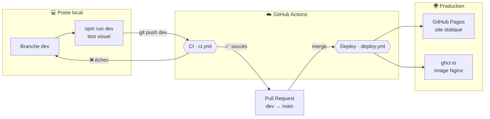

# Portfolio · Aké Mobio Ivan Junior

[](https://github.com/AMij0101982872/AKE-Portfolio/actions/workflows/ci.yml)
[](https://github.com/AMij0101982872/AKE-Portfolio/actions/workflows/deploy.yml)

**Site en ligne → https://amij0101982872.github.io/AKE-Portfolio/**

Portfolio bilingue (FR/EN) d'un élève ingénieur Big Data & IA, construit en **Next.js** et livré par un pipeline **CI/CD** entièrement automatisé : **Docker** pour des builds identiques partout, **GitHub Actions** pour les contrôles qualité et le déploiement, **GitHub Pages** et **GHCR** comme cibles de production.

---

## Sommaire

1. [Stack technique](#1-stack-technique)
2. [Vue d'ensemble du pipeline](#2-vue-densemble-du-pipeline)
3. [Stratégie de branches](#3-stratégie-de-branches)
4. [Le Dockerfile : une seule recette pour tous les environnements](#4-le-dockerfile--une-seule-recette-pour-tous-les-environnements)
5. [CI : contrôle qualité automatique](#5-ci--contrôle-qualité-automatique)
6. [CD : mise en production automatique](#6-cd--mise-en-production-automatique)
7. [Travailler en local](#7-travailler-en-local)
8. [Cycle de mise à jour, pas à pas](#8-cycle-de-mise-à-jour-pas-à-pas)
9. [Modifier le contenu](#9-modifier-le-contenu)
10. [Sécurité et performance](#10-sécurité-et-performance)
11. [Déployer sur un VPS](#11-déployer-sur-un-vps)
12. [Dépannage](#12-dépannage)
13. [Structure du dépôt](#13-structure-du-dépôt)

---

## 1. Stack technique

| Couche | Outils |
|---|---|
| Framework | Next.js 16 (App Router, export statique), React 19, TypeScript |
| Style et animations | Tailwind CSS 4, Motion (ex-Framer Motion) |
| Logos | Simple Icons (CC0), Devicon (MIT) |
| Conteneurisation | Docker multi-stage, Docker Compose, Nginx (non-root) |
| CI/CD | GitHub Actions (cache de build GitHub Actions) |
| Hébergement | GitHub Pages (site), GitHub Container Registry (image Docker) |

---

## 2. Vue d'ensemble du pipeline



| Événement | Workflow | Résultat |
|---|---|---|
| `push` sur `dev` (ou toute branche ≠ `main`) | **CI** | Lint, types, build et smoke test. **Rien n'est publié.** |
| Ouverture ou mise à jour d'une Pull Request | **CI** | Mêmes contrôles, résultat affiché dans la PR |
| `push` / merge sur `main` | **Deploy** | Site publié sur GitHub Pages et image publiée sur GHCR |
| Bouton « Run workflow » (manuel) | **Deploy** | Redéploiement sans nouveau commit |

> **Principe clé :** le site publié sur GitHub Pages et celui servi par l'image Docker proviennent **du même Dockerfile**. Ce qui passe en local passe en CI, et ce qui passe en CI est exactement ce qui part en production.

---

## 3. Stratégie de branches

| Branche | Rôle | Règle |
|---|---|---|
| `dev` | Développement et intégration | On y travaille et on y pousse librement. Chaque push est vérifié par la CI. |
| `main` | Production | On n'y pousse **jamais** directement. Elle n'avance que par merge de `dev`, après une CI verte. |

```
dev   ──●──●──●───────●──●──►        (travail quotidien, CI à chaque push)
              \ merge   \ merge
main  ─────────●─────────●──►        (chaque merge = mise en production)
```

**Protection recommandée** (Settings → Branches → règle sur `main`) :
- *Require a pull request before merging*
- *Require status checks to pass* → cocher **Lint · Types · Build · Smoke test**

---

## 4. Le Dockerfile : une seule recette pour tous les environnements

Le [`Dockerfile`](Dockerfile) est découpé en **5 étapes** (*multi-stage build*). Chaque environnement utilise l'étape qui lui correspond :

```
           ┌─────────────────────────────────────────────┐
           │ 1. deps     npm ci (mis en cache)           │
           └──────────────┬──────────────────────────────┘
               ┌──────────┴───────────┐
               ▼                      ▼
     ┌───────────────────┐  ┌──────────────────────────────────┐
     │ 2. dev            │  │ 3. build                         │
     │ next dev,         │  │ lint → typecheck → next build    │
     │ hot-reload        │  │ (échoue au moindre problème)     │
     └───────────────────┘  └───────┬──────────────────┬───────┘
                                    ▼                  ▼
                         ┌──────────────────┐  ┌───────────────────────┐
                         │ 4. export        │  │ 5. runtime            │
                         │ ./out uniquement │  │ Nginx non-root :8080  │
                         │ → GitHub Pages   │  │ → GHCR / VPS / local  │
                         └──────────────────┘  └───────────────────────┘
```

| Étape | Utilisée par | Contenu |
|---|---|---|
| `deps` | toutes | Node 22 Alpine + `npm ci`, en cache tant que `package-lock.json` ne change pas |
| `dev` | `docker compose up dev` | Serveur Next.js avec rechargement automatique, code monté en volume |
| `build` | CI, `make check` | `npm run lint && npm run typecheck && npm run build` |
| `export` | Deploy (Pages), `make export` | Uniquement les fichiers statiques `./out` (image `scratch`) |
| `runtime` | Deploy (GHCR), CI (smoke test), `docker compose up prod` | Nginx Alpine (~20 Mo), utilisateur non-root, healthcheck |

**Le chemin de base (`NEXT_PUBLIC_BASE_PATH`)** : sur GitHub Pages, le site est servi sous `/AKE-Portfolio/`. Le workflow Deploy récupère ce préfixe automatiquement (`actions/configure-pages`) et le passe au build. En local et dans l'image Docker, il est vide.

---

## 5. CI : contrôle qualité automatique

Fichier : [`.github/workflows/ci.yml`](.github/workflows/ci.yml). Il se déclenche à chaque push hors de `main` et à chaque Pull Request.

| # | Étape | Ce qui est vérifié | Si ça échoue |
|---|---|---|---|
| 1 | **Lint** | Règles ESLint (`eslint-config-next`) | Code non conforme, import inutilisé… |
| 2 | **Typecheck** | `next typegen && tsc --noEmit` | Erreur de typage TypeScript |
| 3 | **Build** | `next build`, génération des pages `/fr` et `/en` | Page qui plante au rendu, import manquant… |
| 4 | **Image runtime** | Construction de l'image Nginx | Erreur dans le Dockerfile ou la config Nginx |
| 5 | **Smoke test** | Lance le conteneur, puis vérifie `/healthz`, `/fr/` et `/en/` | Le site ne démarre pas ou ne répond pas |

Choix techniques :
- **`concurrency` avec `cancel-in-progress`** : un nouveau push annule la CI en cours sur la même branche, ce qui évite de gaspiller des minutes.
- **Cache GitHub Actions (`type=gha`)** : les couches Docker (dont `npm ci`) sont réutilisées d'un run à l'autre, ce qui rend les builds bien plus rapides.
- **`permissions: contents: read`** : la CI n'a que le droit de lire le code (principe du moindre privilège).

---

## 6. CD : mise en production automatique

Fichier : [`.github/workflows/deploy.yml`](.github/workflows/deploy.yml). Il se déclenche à chaque push sur `main` et lance **3 jobs** :

```
pages-build ──► pages-deploy        (en série)
image                               (en parallèle)
```

| Job | Rôle |
|---|---|
| **pages-build** | Construit l'étape `export` du Dockerfile avec le bon `basePath`, ajoute `.nojekyll`, puis envoie `./out` comme artefact Pages |
| **pages-deploy** | Publie l'artefact sur **GitHub Pages** (environnement `github-pages`) |
| **image** | Construit l'étape `runtime` et la pousse sur **`ghcr.io/amij0101982872/ake-portfolio`** avec deux tags : `latest` et le hash court du commit (ex. `sha-ed0c59a`) |

- **`concurrency: deploy` sans annulation** : deux déploiements ne se chevauchent jamais, ils s'enchaînent dans l'ordre.
- **Le tag `sha-xxxxxxx`** permet de revenir à n'importe quelle version précédente de l'image.
- **Aucun secret à configurer** : l'authentification utilise le `GITHUB_TOKEN` fourni automatiquement par GitHub.

---

## 7. Travailler en local

### Sans Docker (le plus rapide au quotidien)

```bash
npm ci                # une seule fois
npm run dev           # → http://localhost:3000/fr/
```

| Script npm | Effet |
|---|---|
| `npm run dev` | Serveur de développement avec rechargement automatique |
| `npm run lint` | ESLint |
| `npm run typecheck` | Génère les types Next.js puis lance `tsc --noEmit` |
| `npm run build` | Build de production → `./out` |

> ⚠️ Ne lance jamais `npm run build` pendant que `npm run dev` tourne : les deux écrivent dans `.next` et le serveur de dev plante. Fais d'abord `Ctrl + C`.

### Avec Docker (identique à la production)

Docker Desktop doit être lancé.

| Commande | `make` | Effet | URL |
|---|---|---|---|
| `docker compose up --build dev` | `make dev` | Dev avec hot-reload | http://localhost:3000/fr/ |
| `docker compose up --build prod` | `make prod` | Image Nginx de production | http://localhost:8080 |
| `docker build --target build .` | `make check` | Exactement les contrôles de la CI | — |
| `docker build --target export --output type=local,dest=out .` | `make export` | Génère `./out` | — |
| `docker compose down` | `make stop` | Arrête les conteneurs | — |

> Sous Windows, `make` n'est pas installé par défaut : utilise directement les commandes `docker`.

---

## 8. Cycle de mise à jour, pas à pas

```bash
# 1. Partir d'une branche dev à jour
git switch dev
git pull
git pull origin main

# 2. Modifier (le plus souvent src/content/profile.ts), puis vérifier
npm run dev                       # contrôle visuel sur http://localhost:3000/fr/
npm run lint && npm run typecheck # facultatif : la CI le fera aussi

# 3. Enregistrer et envoyer
git add .
git commit -m "Ajout du projet X"
git push                          # → la CI se lance sur dev
```

4. Attendre que la CI soit **verte ✅** (onglet **Actions**).
5. Ouvrir une Pull Request **`dev` → `main`** : https://github.com/AMij0101982872/AKE-Portfolio/compare/main...dev
6. **Merge** : le workflow Deploy publie le site en 2 à 3 minutes.

**Revenir en arrière** si une version en ligne pose problème :

```bash
git switch dev
git revert <hash-du-commit>   # crée un commit qui annule le précédent
git push                      # puis PR dev → main comme d'habitude
```

---

## 9. Modifier le contenu

Tout le contenu est séparé du code : **pas besoin de toucher aux composants** pour mettre à jour le site.

| Je veux changer… | Fichier |
|---|---|
| Textes, projets, stages, formation, compétences, certifications | [`src/content/profile.ts`](src/content/profile.ts) |
| Libellés d'interface (menus, boutons, titres) | [`src/content/i18n.ts`](src/content/i18n.ts) |
| Logo associé à une compétence | [`src/components/SkillLogo.tsx`](src/components/SkillLogo.tsx) |
| Photo | `public/ivan-ake.jpg` (garder le même nom) |
| CV téléchargeable | `public/cv-ivan-ake.pdf` (garder le même nom) |
| Images des certificats | `public/certifications/` |

Chaque texte existe en deux langues : `{ fr: "…", en: "…" }`. Ajouter `featured: true` à un projet ou à une certification le met en avant en grande carte.

---

## 10. Sécurité et performance

**Image Docker**
- Nginx tourne avec un **utilisateur non-root** (`USER nginx`), sur le port 8080.
- **Healthcheck** intégré sur `/healthz` : Docker et l'orchestrateur savent si le conteneur répond.
- Dans `compose.yaml`, le service `prod` tourne en **système de fichiers en lecture seule** (`read_only: true`).
- Le `.dockerignore` exclut `.git`, `.env*`, `node_modules`… du contexte de build.

**Configuration Nginx** ([`docker/nginx.conf`](docker/nginx.conf))
- En-têtes de sécurité : `X-Content-Type-Options`, `X-Frame-Options: DENY`, `Referrer-Policy` ; version de Nginx masquée.
- Compression **gzip** des fichiers texte, CSS, JS et SVG.
- **Cache d'un an** (`immutable`) sur `/_next/static/`, dont les fichiers changent de nom à chaque build ; revalidation systématique des pages HTML.

**Site**
- **Export 100 % statique** : aucun serveur applicatif, aucune base de données, donc rien à attaquer côté serveur.
- Polices auto-hébergées (pas d'appel à Google Fonts) : le build est reproductible hors ligne.
- Animations limitées à `transform` et `opacity`, et désactivées si l'utilisateur a demandé à réduire les animations.

---

## 11. Déployer sur un VPS

L'image de production est publiée à chaque mise en ligne. Sur n'importe quel serveur avec Docker :

```bash
docker run -d --name portfolio -p 80:8080 --restart unless-stopped \
  ghcr.io/amij0101982872/ake-portfolio:latest
```

Pour une version précise : remplacer `latest` par le tag du commit, par exemple `sha-ed0c59a`.

> Si le package GHCR est privé : `docker login ghcr.io`, ou le passer en public dans les réglages du package sur GitHub.

---

## 12. Dépannage

| Symptôme | Cause | Solution |
|---|---|---|
| `npm error enoent` | Commande lancée dans le mauvais dossier | Se placer dans le dossier qui contient `package.json` |
| Page blanche avec « Jest worker encountered 2 child process exceptions » | `npm run build` lancé pendant `npm run dev` | `Ctrl + C`, supprimer `.next`, relancer `npm run dev` |
| `Cannot find name 'PageProps'` / `'LayoutProps'` | Types Next.js non générés | Utiliser `npm run typecheck`, qui lance `next typegen` d'abord |
| `localhost:3000` ne répond pas | Le serveur de dev n'est pas lancé | `npm run dev` et attendre `✓ Ready` |
| CI rouge ❌ | Lint, types, build ou smoke test en échec | Ouvrir le run dans **Actions**, lire l'étape en rouge, corriger sur `dev`, pousser |
| Le site en ligne ne change pas | Merge pas encore fait, ou Deploy en échec | Vérifier le workflow **Deploy** dans **Actions** |
| 404 sur GitHub Pages | Pages pas configuré | **Settings → Pages → Source : GitHub Actions** |

---

## 13. Structure du dépôt

```
.
├── .github/workflows/
│   ├── ci.yml              # CI : lint, types, build, smoke test
│   └── deploy.yml          # CD : GitHub Pages + image GHCR
├── docker/
│   └── nginx.conf          # Configuration Nginx de production
├── public/
│   ├── certifications/     # Images des certificats
│   ├── logos/              # Logos Devicon (AWS, Oracle, SQL Server, Matplotlib)
│   ├── cv-ivan-ake.pdf     # CV téléchargeable
│   └── ivan-ake.jpg        # Photo
├── src/
│   ├── app/
│   │   ├── (root)/         # Page "/" : redirige vers /fr/ ou /en/
│   │   ├── [lang]/         # Page principale, générée en FR et en EN
│   │   └── globals.css     # Thème (clair / sombre), effets 3D
│   ├── components/         # Sections, animations, galerie, logos, icônes
│   ├── content/
│   │   ├── profile.ts      # ← TOUT le contenu du portfolio
│   │   └── i18n.ts         # Libellés d'interface FR / EN
│   └── lib/paths.ts        # Gestion du préfixe GitHub Pages
├── Dockerfile              # Build multi-stage : deps · dev · build · export · runtime
├── compose.yaml            # Services dev et prod en local
├── Makefile                # Raccourcis (make dev, make check…)
└── next.config.ts          # Export statique, basePath
```
